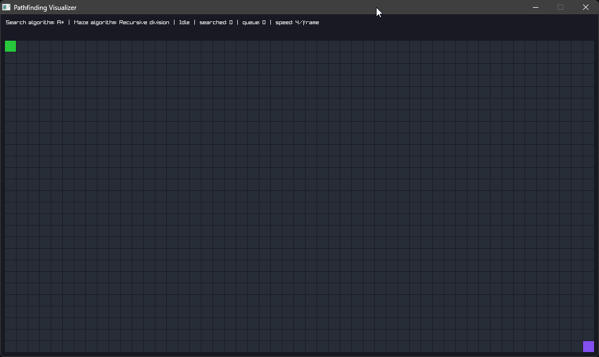
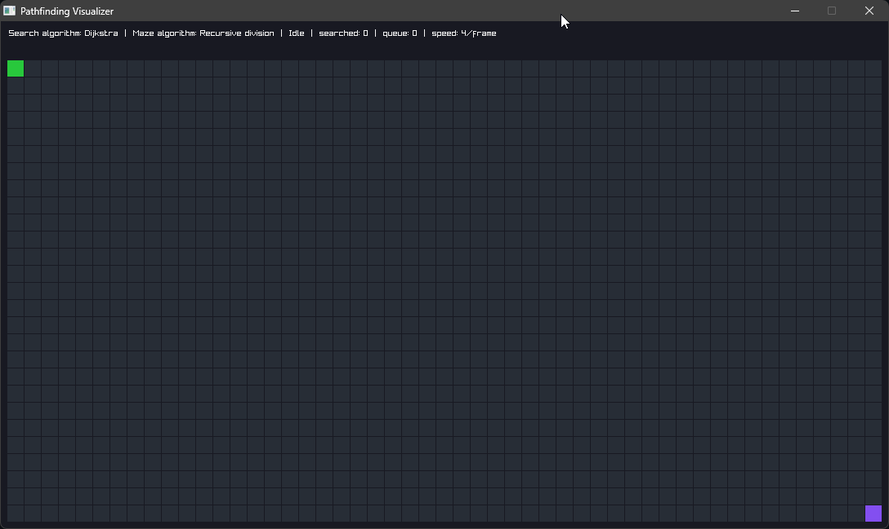

# raylib-pathfinder

Grid pathfinding visualizer (Dijkstra and A*) written in C with raylib.

Draw walls, then drag the start and goal nodes. The path updates live. If walls block the goal, a red path leads to the closest searched node.



Dijkstra solving a generated maze.



## Controls

| Input | Action |
|---|---|
| Left mouse drag | Paint walls, or drag the start/goal node (not while a search is running) |
| Right mouse drag | Erase walls (not while a search is running) |
| `S` / `Space` | Start search (single step while paused) |
| `Shift` + `S` | Step one frame's worth while paused |
| `P` | Pause / resume |
| `Left` / `Right` | Speed -1 / +1 steps per frame (`Shift`: 4) |
| `1` / `2` | Dijkstra / A* |
| `Shift` + `1` / `2` | Recursive division / randomized Prim's maze (clears grid) |
| `G` | Generate maze (not while a search is running) |
| `R` | Clear grid |
| `Esc` | Quit |

## Build

Requires CMake 3.26+, Ninja and a C compiler. raylib is fetched automatically.

```sh
cmake --preset release
cmake --build --preset release
```

Binary: `build/release/raylib-pathfinder`. Use `debug` in place of `release` for a debug build.
